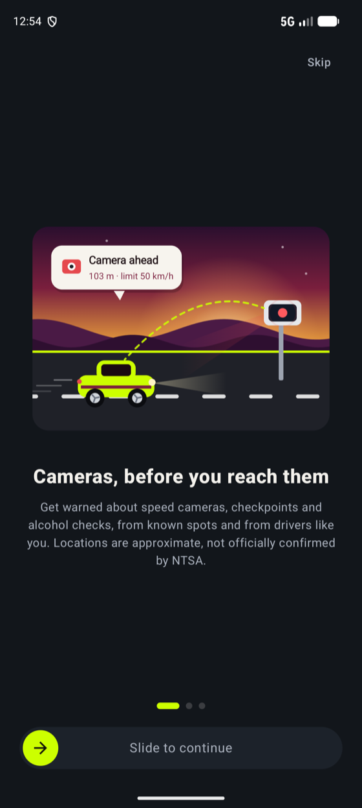
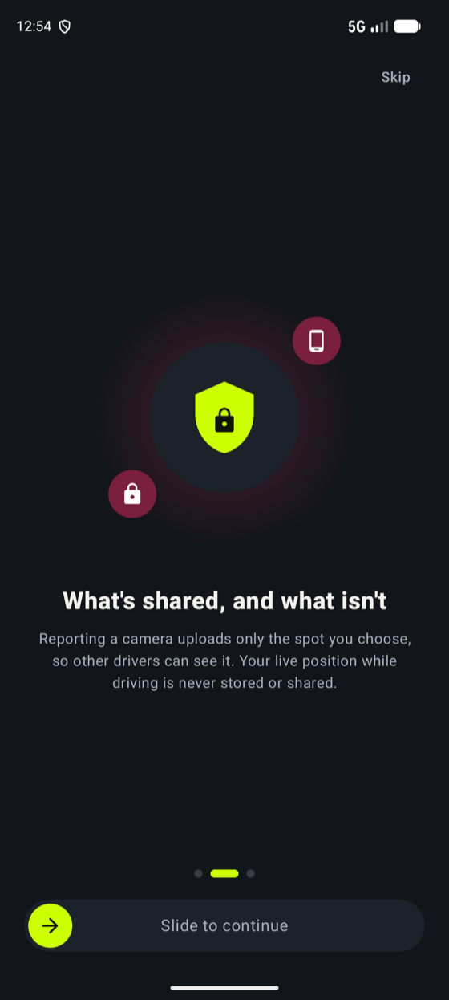
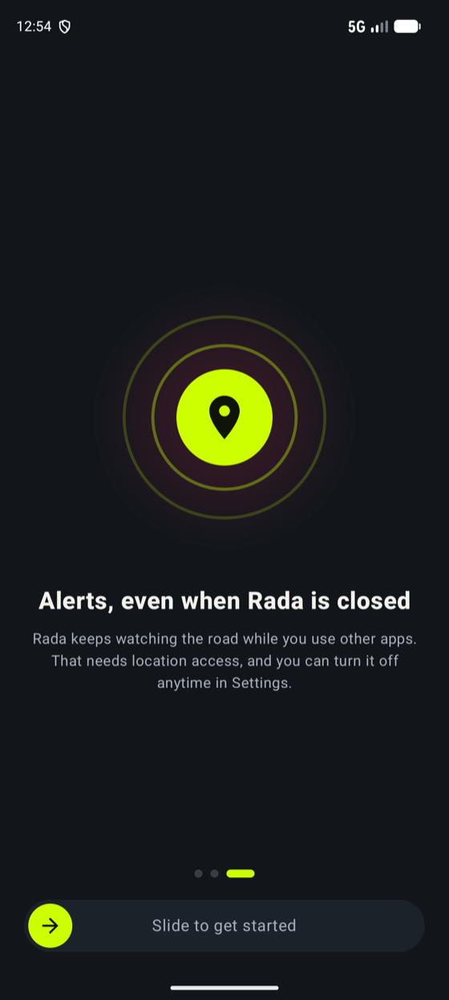
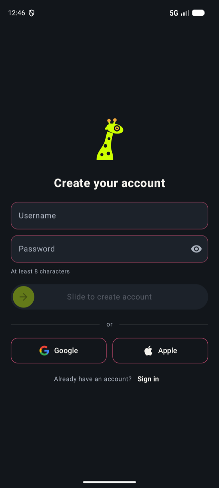
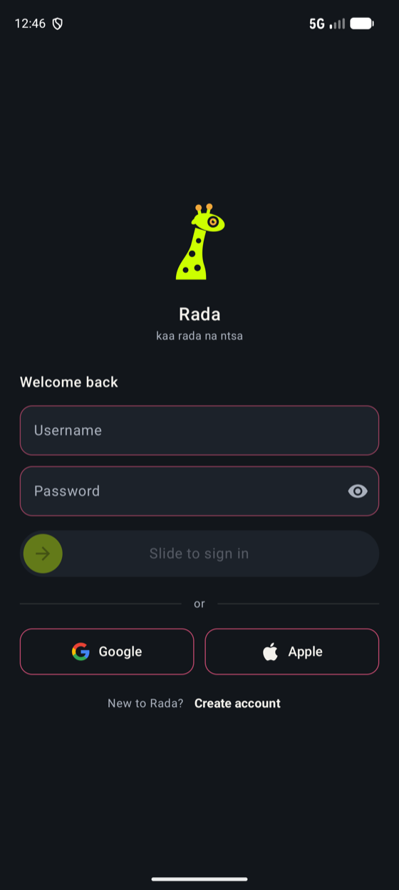
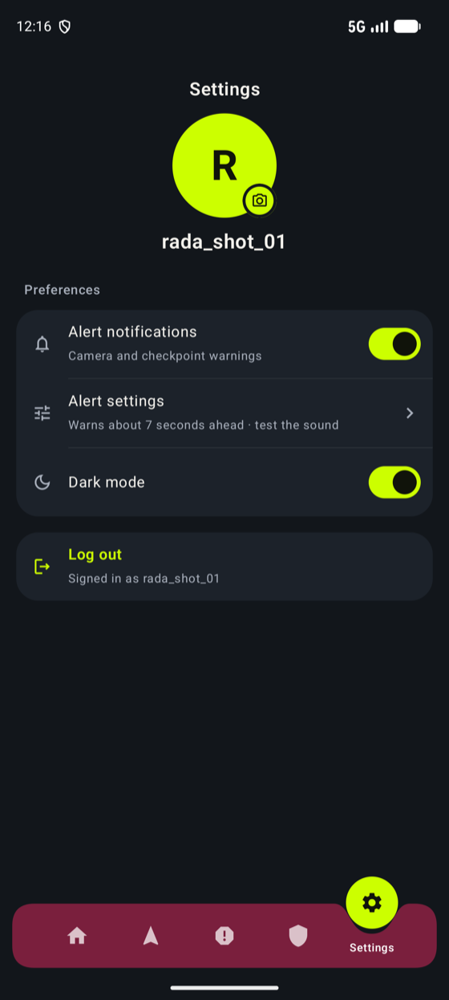
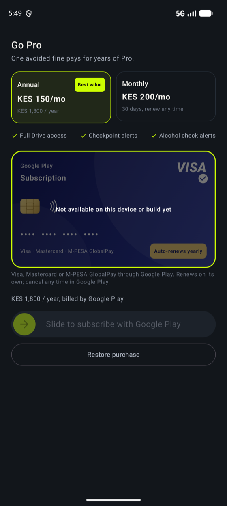
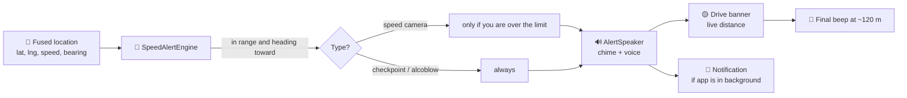
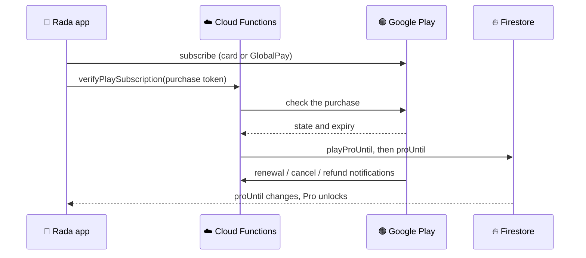

<p align="center">
  
</p>

<h1 align="center">🦒 Rada</h1>

<p align="center">
  <b>kaa rada na ntsa</b> · <i>stay aware on the road</i>
</p>

<p align="center">
  
  
  
  
  
</p>

<p align="center">
  A Kenyan driving-awareness app that speaks up <b>before</b> the camera, the checkpoint or the
  alcoblow, so you never find out the hard way. 🇰🇪
</p>

---

## 🌍 The idea

*Rada* is Swahili for **aware**. It isn't a radar detector; it's a community of drivers looking out
for each other. Rada combines a seeded map of known **speed cameras** with live reports of **police
checkpoints** and **alcohol checks** from other drivers, and warns you with a chime and a spoken
message in time to react.

The mascot is the **Twiga** (giraffe): the tallest lookout on the savanna, with a camera lens for an
eye. 👁️

## 📸 Screenshots

<p align="center"><b>🚀 First run: onboarding and sign-in</b></p>

<table align="center">
  <tr>
    <td align="center"><br><sub>Splash</sub></td>
    <td align="center"><br><sub>Cameras, before you reach them</sub></td>
    <td align="center"><br><sub>What's shared, and what isn't</sub></td>
  </tr>
  <tr>
    <td align="center"><br><sub>Alerts, even when Rada is closed</sub></td>
    <td align="center"><br><sub>Create account</sub></td>
    <td align="center"><br><sub>Sign in</sub></td>
  </tr>
</table>

<p align="center"><b>🛣️ Every day: home, drive, report, help</b></p>

<table align="center">
  <tr>
    <td align="center"><br><sub>Home (dark)</sub></td>
    <td align="center"><br><sub>Home (light)</sub></td>
    <td align="center"><br><sub>Drive mode</sub></td>
  </tr>
  <tr>
    <td align="center"><br><sub>One-tap reporting</sub></td>
    <td align="center"><br><sub>Roadside help</sub></td>
    <td align="center"><br><sub>Settings</sub></td>
  </tr>
  <tr>
    <td align="center" colspan="3"><br><sub>Go Pro: pay by card through Google Play</sub></td>
  </tr>
</table>

<p align="center"><sub>Android, captured on an emulator. Alerts and chart data in these shots are test reports.</sub></p>

## ✨ What it does

| | Feature | The details |
|---|---|---|
| 🚗 | **Drive mode** | A live map that stays locked on your car (a burgundy car marker), your speed, and how many cameras are near. The zoom adapts to your speed and widens to keep an approaching camera on screen. |
| 🔔 | **Loud, timely alerts** | A two-tone chime, then a spoken warning that includes the speed limit for fixed cameras, such as *"Speed camera
  ahead, Thika Road. 300 metres. Limit 80 kilometres per hour."*, then a three-beep final warning about 120 m out. Music ducks instead of stopping, and alerts keep working with the screen off. |
| ⏱️ | **Warning distance** | Choose how early you're warned: **Standard** (about 7 s ahead), **Early** (10 s) or **Earliest** (14 s), so highway drivers get more time. |
| 👆 | **One-tap reporting** | Camera, checkpoint or alcohol check, one tap each. The tile floods with colour, you feel a haptic tick, and an **Undo** chip stays for five seconds so a mis-tap while driving is recoverable. |
| 📊 | **Home dashboard** | **Real** estimated fines avoided (cameras you slowed down for, tracked on your account), a weekly line chart of reports by type (amber camera, blue checkpoint, red alcohol), and the newest alerts near you. |
| 🆘 | **Roadside help** | Emergency numbers, tow companies and mechanics, one tap to call. |
| 🎛️ | **Settings** | Your name (from your account) and profile photo (tap the camera to change or remove it), alert switch, an **Alert settings** sheet (warning distance and a **Test alert sound** button), a dark-mode switch and Log out. Everything saves as you change it; there is no Save button. |
| 🌗 | **Light and dark themes** | A lime-on-ink identity with burgundy accents, and an adaptive launcher icon (with a themed variant on Android 13+). |
| 👑 | **Rada Pro** | Try Drive **free for 7 days**, then unlock it with a Google Play subscription. See [Pricing and payments](#-pricing-and-payments). |

## 🚦 How an alert happens



- **Distance scales with speed.** The warning fires about 7 to 14 seconds ahead (your setting),
  clamped between 60 m and 350 to 700 m.
- **Direction matters.** Only cameras you're heading toward (within ±20°) count, so the camera on
  the opposite carriageway stays quiet.
- **No repeat spam.** Each camera goes `NOT_ALERTED → ALERTED → PASSED`, with hysteresis so it
  doesn't re-fire as you drive by.
- **Did you slow down?** After a warning, the engine tracks the closest approach. If your speed there
  is at or under the limit (plus 2 km/h for GPS noise), the camera is counted as evaded and the
  estimated fine is added to your month. If you didn't slow down, only the warning is counted.
- **Fast lookups.** `CameraGridIndex` buckets cameras into ~1 km cells so each location update
  only checks the cameras around you.
- **Survives the background.** Fixed a real bug: the app used to stop its own tracking service
  the instant you left the Drive tab, which killed the foreground-service notification and left
  Android free to throttle location delivery — exactly the moment a driver checks WhatsApp.
  Tracking now keeps running across tabs and other apps until you stop it (the notification's
  Stop action, or signing out); the service also asks Android to restart it if the OS is forced
  to kill it. **Confirmed:** GPS fixes keep arriving with Drive off-screen and another app
  fully in the foreground, on the emulator. **Not yet confirmed:** behaviour after the *whole
  app process* is killed by an aggressive OEM battery manager on a real phone (see the battery
  prompt below) — this needs a real, long drive to verify.
  music, and a watchdog restarts location if GPS updates stall.

> [!NOTE]
> Camera locations come from public sources and reports. Some are **approximate** and are flagged as
> such in the app. Spots still missing usable coordinates are listed in
> [`docs/cameras-todo.md`](docs/cameras-todo.md).

## 💳 Pricing and payments

| Plan | Price | What you get |
|---|---|---|
| 🎁 **Free trial** | 7 days, once per account | Full Drive access |
| 📅 **Monthly** | KES 200 for 30 days | Keep Drive after the trial, plus alcohol-check alerts |
| 🏆 **Annual** | KES 1,800 for 365 days | Everything in Monthly, about KES 150 a month |

One payment route: a **Google Play subscription**, paid by Visa, Mastercard (including
**M-PESA GlobalPay** virtual cards) or M-Pesa where Google offers it at checkout. It auto-renews
and is cancelled any time in Google Play.

> [!NOTE]
> An earlier version also offered M-Pesa STK push (Safaricom Daraja) as a direct, pay-once
> route. It was removed after the production Till application was rejected. Google Play Billing
> is the only in-app purchase route now — see [Payment policy](#-payment-policy-why-only-google-play) for why we're not adding
> PayPal or another direct gateway alongside it.



A Play purchase is bound to the account that bought it (an obfuscated account id, checked
server-side), and only Cloud Functions can write `proUntil` — never the client. Details are in
[`functions/README.md`](functions/README.md).

## 🛡️ Payment policy: why only Google Play

Rada Pro is a digital subscription consumed inside the app, which puts it squarely under
**Google Play's Payments policy**: real-money purchases of digital content must go through
Google Play Billing, with narrow exceptions (physical goods/services, or an approved
alternative-billing program in specific countries — unconfirmed for Kenya). Adding a direct
gateway like PayPal *alongside* Play Billing for the same digital subscription is exactly what
that policy exists to prevent, and risks the listing itself, not just a feature. "Other apps on
the Play Store take PayPal" is almost always apps selling physical goods or off-app services
(ride-hailing, food delivery), which are exempt for a different reason than ours would be.

M-Pesa GlobalPay and any other Visa/Mastercard-branded card already works today — through Google
Play Billing, which is card-agnostic. That's covered without a second integration.

## 🔐 Accounts and security

- 👤 **Username and password**, or **Google** or **Apple**. Sign in once and stay signed in.
- ⏳ **The free trial can't be reset.** The start date is stored on the account in Firestore with a
  server timestamp, so clearing app data or reinstalling doesn't restart it.
- 🛡️ **Firestore rules** ([`firestore.rules`](firestore.rules)): reports need a signed-in user and
  can only be deleted by their author; Play purchase records are Cloud-Functions-only, not
  readable or writable by any client; no client can grant itself Pro or edit its trial.
- ✅ **Tested against the emulators:** `npm run test:e2e` in `functions/` checks the rules on a
  real Firestore emulator.
- 🔒 **Minimal permissions on purpose.** No `ACCESS_BACKGROUND_LOCATION` — Rada only ever accesses
  location from a running foreground service, which Android already permits on "while in use"
  permission alone, so the extra permission (and Play's background-location review step) buys
  nothing. No `CALL_PHONE` — Roadside help opens the dialer with `ACTION_DIAL`, which needs no
  permission at all. No `android:allowBackup` — auth and account data never leaves the device
  through a backup.

<details>
<summary><b>How usernames work, and console notes</b></summary>

<br>

Firebase signs people in with an email address, so a username such as `wanjiru` is turned into an
internal address, `wanjiru@users.rada.invalid`, which never receives mail. That makes usernames
unique for free. The trade-off is that **there is no password recovery**. To add it later, collect a
real email address at sign-up and store it on the account.

1. **Authentication → Sign-in method:** enable **Email/Password**. That's all username and password
   needs: no fingerprint, SMS region or Play Integrity.
2. **Google (optional):** enable the Google provider, add your SHA-1 and SHA-256
   (`./gradlew :androidApp:signingReport`) under Project settings → your Android app, then download
   `google-services.json` again.
3. **Apple (optional):** needs an Apple Developer account: create a Services ID and a Sign in with
   Apple key, enter them in Firebase, and add Firebase's callback URL to the Services ID.
4. **Firestore rules:** publish [`firestore.rules`](firestore.rules).

</details>

## 🧱 Tech stack, and why

| | Layer | Choice | Why |
|---|---|---|---|
| 🧠 | Shared logic | **Kotlin Multiplatform** (`:shared`) | The alert engine has to be right, so it is written once and reused by both apps instead of being re-implemented per platform. |
| 🎨 | Android UI | **Jetpack Compose** + Material 3 | Declarative UI makes the animated screens (tab bar, report tiles, charts, the moving map) straightforward. |
| 🍎 | iOS UI | **SwiftUI** | Native feel, haptics and animation on iPhone. |
| 🏛️ | Architecture | **MVI**: one immutable state per screen, intents in, effects out | Predictable and easy to reason about. Each feature is a `Route` (owns the ViewModel) plus a `Content` screen that is a pure function of state. |
| 🧭 | Navigation | **Navigation Compose**, one tab bar above the `NavHost` | The active-tab circle slides between destinations instead of being redrawn per screen. |
| 💾 | Local storage | **Jetpack DataStore** | Small key-value data (theme, name, alert settings, report history), written as it changes. |
| 🔥 | Backend | **Firebase Auth + Firestore + Cloud Functions** | Realtime crowd reports with an offline write queue, and payment logic on a server with no servers to run. |
| 📍 | Location | **Play Services Fused Location** + a foreground service | One high-accuracy request while Drive is tracking, kept alive in the background. |
| 🗺️ | Maps | **Maps Compose** (Google Maps SDK) | Fastest route to a good map with a custom animated car marker. |
| 🔊 | Audio | **AudioTrack chimes + Android TextToSpeech** | No audio assets to ship; navigation-guidance audio focus ducks your music. |
| 💚 | Payments | **Google Play Billing** + **M-Pesa Daraja STK push** | Cards, GlobalPay and automatic renewal through Play; M-Pesa for people who want to pay directly. |
| ⚡ | Async | **Kotlin Coroutines / Flow** | Location, Firestore and DataStore are all streams. |
| 🛠️ | Build | Gradle Kotlin DSL · AGP 8.13 · Kotlin 2.3 · JDK 17 · minSdk 26 · targetSdk 36 · Node 24 for functions | |

## 🗂️ Project layout

```
shared/          Kotlin Multiplatform: SpeedAlertEngine, CameraGridIndex, models,
                 LocationProvider / AlertNotifier (expect/actual for Android and iOS)
androidApp/      Jetpack Compose app
  └ features/    splash · onboarding · login · signup · dashboard · drive · report · help ·
                 settings · paywall   (each: State + ViewModel + Route + Content)
  └ data/        Firestore repositories, DataStore preferences, auth and trial sync
  └ tracking/    foreground service, alert notifications, AlertSpeaker (chime + voice)
  └ theme/       palette + light/dark colour schemes
functions/       Cloud Functions (Node 24): Google Play subscription verification, notifications, tests
iosApp/          SwiftUI app (see iosApp/SETUP.md)
docs/            screenshots, brand assets, camera data notes
firestore.rules  Security rules for reports, Play purchases and accounts
```

## 🚙 Hands-free and in-car

- **App shortcuts.** Long-press the Rada icon for **Report camera**, **Report checkpoint** and
  **Report alcohol check**. Each submits instantly with your current location and speaks a short
  confirmation ("Speed camera reported near Thika Road. Thanks for the heads-up.") with no screen
  to look at. Falls back to opening the app if you're signed out or haven't granted location.
- **Ready for "Hey Google, report a camera on Rada".** The shortcuts declare Google Assistant
  App Action capabilities (`actions.intent.REPORT_CAMERA` and friends). Voice phrases still need
  to be registered and tested in Play Console's App Actions tool before they work by voice.
- **Alerts in the car.** The chime and spoken warnings use navigation-guidance audio, the same
  category Google Maps and Waze use, so they duck your music and should play over Bluetooth or
  Android Auto automatically. **Not yet confirmed on a real Android Auto head unit** — please try
  it and tell us what you hear.
- **A first Android Auto screen exists now.** `RadaCarAppService` shows current speed, the active
  alert (with distance and speed limit) and a "this drive" evaded/warnings count on the car's
  display, sharing live state with the phone's Drive screen via `CarDriveState`. Declared under
  the **IoT** category — the pragmatic fit among Google's fixed Car App Library categories
  (Navigation, POI, IoT, Weather, Media, Messaging, Calling), since Rada does proximity alerts,
  not turn-by-turn routing. **Confirmed:** the system correctly resolves the service via `dumpsys package`, and a real car test found and fixed a genuine bug — the host validator was empty (trusting *no* host, not even Android Auto's own), so the car couldn't connect regardless of Unknown Sources. Debug builds now trust any host; production would need Google's real host allowlist here instead. **Not yet confirmed:** whether it now actually shows up and how it looks on a real head unit. Enable **Settings → About →
  (tap build number) → Developer options → Unknown sources** in the Android Auto app on your
  phone to sideload-test this before it's on Play; that gate also means the IoT-category choice
  may need Google's sign-off to be honest and stable for a real public listing later.
- **CarPlay** needs a real iOS app first and an Apple entitlement — not started.

## 🗺️ Where things stand

Legend: ✅ working · 🧪 tested, needs a live check · 🚧 in progress · 🔜 next

| | Area | Status |
|---|---|---|
| ✅ | Alert engine, grid index, live map, camera-following and adaptive zoom | Working; **audio alerts confirmed on a real drive** |
| ✅ | Crowd reports: submit, undo, live alerts, weekly chart | Working |
| ✅ | Fines-avoided tracking | A camera counts as evaded when you got a warning and were at or under the limit as you passed it; the estimate uses KES 10,000 per fine. Stored per account and month, covered by engine and rules tests |
| ✅ | Username and password sign-in, persistent sessions | Working end to end |
| ✅ | Free trial tied to the account | Verified: wiping app data no longer restarts it |
| ✅ | Firestore security rules | Published and covered by emulator tests |
| 🧪 | Google Play subscriptions | App, verification and notification handling built and unit-tested; **needs the Play Console setup** (products, API access) before a real purchase |
| 🧪 | Google sign-in | Implemented; needs the SHA-1 registered, then a device check |
| 🚧 | Apple sign-in | Implemented; needs Apple Developer setup |
| 🚧 | iOS app | A SwiftUI prototype with mock data; no location, map or sign-in yet |
| 🔜 | Password recovery | Collect a real email at sign-up |
| 🔜 | Renewal reminders | A nudge a few days before Pro ends |
| 🔜 | Offline maps | Not built; not promised on the paywall either, since we don't ship it yet |
| 🔜 | Remaining camera coordinates | See [`docs/cameras-todo.md`](docs/cameras-todo.md) |

> [!IMPORTANT]
> The tow and mechanic phone numbers are still placeholders, and the iOS prototype still uses mock
> data for its Home card.

## 📜 License

Private project. No licence is granted. 🔒

<p align="center"><sub>Made in Nairobi 🇰🇪 · <b>kaa rada na ntsa</b></sub></p>
