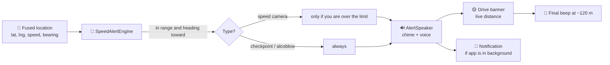
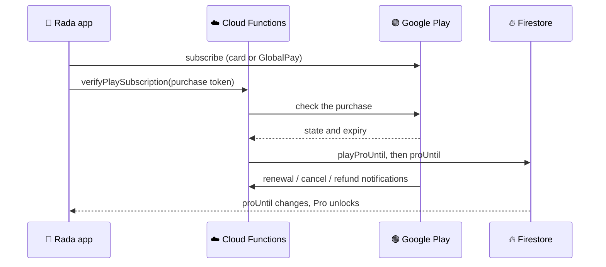

<p align="center">
  
</p>

<h1 align="center">🦒 Rada</h1>

<p align="center">
  <b>kaa rada na ntsa</b> · <i>stay aware on the road</i>
</p>

<p align="center">
  
  
  
  
  
</p>

<p align="center">
  A Kenyan driving-awareness app that speaks up <b>before</b> the camera, the checkpoint or the
  alcoblow, so you never find out the hard way. 🇰🇪
</p>

---

## 🌍 The idea

*Rada* is Swahili for **aware**. It isn't a radar detector; it's a community of drivers looking out
for each other. Rada combines a seeded map of known **speed cameras** with live reports of **police
checkpoints** and **alcohol checks** from other drivers, and warns you with a chime and a spoken
message in time to react.

The mascot is the **Twiga** (giraffe): the tallest lookout on the savanna, with a camera lens for an
eye. 👁️

## 📸 Screenshots

<p align="center"><b>🚀 First run: onboarding and sign-in</b></p>

<table align="center">
  <tr>
    <td align="center"><br><sub>Splash</sub></td>
    <td align="center"><br><sub>Cameras, before you reach them</sub></td>
    <td align="center"><br><sub>What's shared, and what isn't</sub></td>
  </tr>
  <tr>
    <td align="center"><br><sub>Alerts, even when Rada is closed</sub></td>
    <td align="center"><br><sub>Create account</sub></td>
    <td align="center"><br><sub>Sign in</sub></td>
  </tr>
</table>

<p align="center"><b>🛣️ Every day: home, drive, report, help</b></p>

<table align="center">
  <tr>
    <td align="center"><br><sub>Home (dark)</sub></td>
    <td align="center"><br><sub>Home (light)</sub></td>
    <td align="center"><br><sub>Drive mode</sub></td>
  </tr>
  <tr>
    <td align="center"><br><sub>One-tap reporting</sub></td>
    <td align="center"><br><sub>Roadside help</sub></td>
    <td align="center"><br><sub>Settings</sub></td>
  </tr>
  <tr>
    <td align="center" colspan="3"><br><sub>Go Pro: pay by card through Google Play</sub></td>
  </tr>
</table>

<p align="center"><sub>Android, captured on an emulator. Alerts and chart data in these shots are test reports.</sub></p>

## ✨ What it does

| | Feature | The details |
|---|---|---|
| 🚗 | **Drive mode** | A live map that stays locked on your car (a burgundy car marker), your speed, and how many cameras are near. The zoom adapts to your speed and widens to keep an approaching camera on screen. |
| 🔔 | **Loud, timely alerts** | A two-tone chime, then a spoken warning that includes the speed limit for fixed cameras, such as *"Speed camera ahead, Thika Road. 300 metres. Limit 80 kilometres per hour."*, then a three-beep final warning about 120 m out. Music ducks instead of stopping, and alerts keep working with the screen off or another app open. |
| ⏱️ | **Warning distance** | Choose how early you're warned: **Standard** (about 7 s ahead), **Early** (10 s) or **Earliest** (14 s), so highway drivers get more time. |
| 👆 | **One-tap reporting** | Camera, checkpoint or alcohol check, one tap each. The tile floods with colour, you feel a haptic tick, and an **Undo** chip stays for five seconds so a mis-tap while driving is recoverable. Long-press the app icon for **Report camera / checkpoint / alcohol check** shortcuts that submit instantly with a spoken confirmation, no screen needed. |
| 📊 | **Home dashboard** | Estimated fines avoided (cameras you slowed down for, tracked on your account), a weekly line chart of reports by type (amber camera, blue checkpoint, red alcohol), and the newest alerts near you. |
| 🆘 | **Roadside help** | Emergency numbers, tow companies and mechanics, one tap to call. |
| 🎛️ | **Settings** | Your name (from your account) and profile photo, alert switch, an **Alert settings** sheet (warning distance and a test-sound button), a dark-mode switch and Log out. Everything saves as you change it; there is no Save button. |
| 🌗 | **Light and dark themes** | A lime-on-ink identity with burgundy accents, and an adaptive launcher icon (with a themed variant on Android 13+). |
| 👑 | **Rada Pro** | Try Drive **free for 7 days**, then unlock it with a Google Play subscription. See [Pricing and payments](#-pricing-and-payments). |
| 🚙 | **Android Auto** | A car-screen view showing current speed, the active alert and a this-drive evaded/warnings count, sharing live state with the phone's Drive screen. |

## 🚦 How an alert happens



- **Distance scales with speed.** The warning fires about 7 to 14 seconds ahead (your setting),
  clamped between 60 m and 350 to 700 m.
- **Direction matters.** Only cameras you're heading toward (within ±20°) count, so the camera on
  the opposite carriageway stays quiet.
- **No repeat spam.** Each camera goes `NOT_ALERTED → ALERTED → PASSED`, with hysteresis so it
  doesn't re-fire as you drive by.
- **Did you slow down?** After a warning, the engine tracks the closest approach. If your speed
  there is at or under the limit (plus 2 km/h for GPS noise), the camera is counted as evaded and
  the estimated fine is added to your month. If you didn't slow down, only the warning is counted.
- **Fast lookups.** `CameraGridIndex` buckets cameras into ~1 km cells so each location update
  only checks the cameras around you.
- **Runs as a foreground service.** `TrackingService` owns the whole engine — location, alert
  evaluation, speech, notifications and stats — independently of whatever screen is on top, so
  Drive keeps watching while you're on WhatsApp, Maps or with the screen off, until you stop it
  from the persistent notification or sign out.

> [!NOTE]
> Camera locations come from public sources and reports. Some are **approximate** and are flagged
> as such in the app. Spots still missing usable coordinates are listed in
> [`docs/cameras-todo.md`](docs/cameras-todo.md).
>
> The seeded speed-camera database is Nairobi-focused. Checkpoint and alcohol-check alerts work
> anywhere, since those come entirely from other drivers' live reports rather than the seeded
> list.

## 💳 Pricing and payments

| Plan | Price | What you get |
|---|---|---|
| 🎁 **Free trial** | 7 days, once per account | Full Drive access |
| 📅 **Monthly** | KES 200 for 30 days | Keep Drive after the trial, plus alcohol-check alerts |
| 🏆 **Annual** | KES 1,800 for 365 days | Everything in Monthly, about KES 150 a month |

A Google Play subscription, paid by Visa, Mastercard (including M-PESA GlobalPay virtual cards)
or M-Pesa where Google offers it at checkout. It auto-renews and is cancelled any time in Google
Play.



A Play purchase is bound to the account that bought it (an obfuscated account id, checked
server-side), and only Cloud Functions can write `proUntil` — never the client. Details are in
[`functions/README.md`](functions/README.md).

### Why only Google Play

Rada Pro is a digital subscription consumed inside the app, which falls under Google Play's
Payments policy: real-money purchases of digital content go through Google Play Billing, with
narrow exceptions (physical goods/services, or an approved alternative-billing program in
specific countries) that don't apply here. Google Play Billing is card-agnostic, so Visa,
Mastercard and M-PESA GlobalPay are already covered through it without a second integration.

## 📦 Release build

Play Console requires a signed build before Play Billing can be tested — an internal testing
upload has to be signed.

1. Generate your own upload keystore (do this once, and back it up somewhere durable — losing
   it means losing the ability to update the app, short of Play's key-upgrade process):
   ```
   keytool -genkey -v -keystore rada-upload.keystore -keyalg RSA -keysize 2048 -validity 10000 -alias rada
   ```
2. Add four lines to `local.properties` (git-ignored; never commit these):
   ```
   RADA_RELEASE_STORE_FILE=/absolute/path/to/rada-upload.keystore
   RADA_RELEASE_STORE_PASSWORD=...
   RADA_RELEASE_KEY_ALIAS=rada
   RADA_RELEASE_KEY_PASSWORD=...
   ```
3. Build the App Bundle Play Console needs:
   ```
   ./gradlew :androidApp:bundleRelease
   ```
   `androidApp/build/outputs/bundle/release/androidApp-release.aab` is what you upload.

Without those `local.properties` values, `bundleRelease`/`assembleRelease` still build — just
unsigned, which Play Console will reject.

Release builds run with code obfuscation (R8) on; debug builds never minify. Keep rules live in
`androidApp/proguard-rules.pro` — notably `ReportType`'s enum names (they round-trip through
Firestore as strings) and `androidx.car.app` (the Android Auto integration). Resource shrinking
(`isShrinkResources`) is off; `AuthRepository` looks up Google Sign-In's client ID by resource
name at runtime, and `res/values/keep.xml` protects it for whenever that gets turned on.

## 🔐 Accounts and security

- 👤 **Username and password**, or **Google** or **Apple**. Sign in once and stay signed in.
- ⏳ **The free trial is tied to the account.** The start date is stored in Firestore with a
  server timestamp, so clearing app data or reinstalling doesn't restart it.
- 🛡️ **Firestore rules** ([`firestore.rules`](firestore.rules)): reports need a signed-in user and
  can only be deleted by their author; Play purchase records are Cloud-Functions-only, not
  readable or writable by any client; no client can grant itself Pro or edit its trial.
- 🔒 **Minimal permissions on purpose.** No `ACCESS_BACKGROUND_LOCATION` — Rada only accesses
  location from a running foreground service, which Android permits on "while in use" permission
  alone. No `CALL_PHONE` — Roadside help opens the dialer with `ACTION_DIAL`, which needs no
  permission at all. No `android:allowBackup` — auth and account data never leaves the device
  through a backup.

<details>
<summary><b>How usernames work, and console notes</b></summary>

<br>

Firebase signs people in with an email address, so a username such as `wanjiru` is turned into an
internal address, `wanjiru@users.rada.invalid`, which never receives mail. That makes usernames
unique for free. The trade-off is that **there is no password recovery**. To add it later, collect a
real email address at sign-up and store it on the account.

1. **Authentication → Sign-in method:** enable **Email/Password**. That's all username and password
   needs: no fingerprint, SMS region or Play Integrity.
2. **Google (optional):** enable the Google provider, add your SHA-1 and SHA-256
   (`./gradlew :androidApp:signingReport`) under Project settings → your Android app, then download
   `google-services.json` again.
3. **Apple (optional):** needs an Apple Developer account: create a Services ID and a Sign in with
   Apple key, enter them in Firebase, and add Firebase's callback URL to the Services ID.
4. **Firestore rules:** publish [`firestore.rules`](firestore.rules).

</details>

## 🧱 Tech stack, and why

| | Layer | Choice | Why |
|---|---|---|---|
| 🧠 | Shared logic | **Kotlin Multiplatform** (`:shared`) | The alert engine has to be right, so it is written once and reused by both apps instead of being re-implemented per platform. |
| 🎨 | Android UI | **Jetpack Compose** + Material 3 | Declarative UI makes the animated screens (tab bar, report tiles, charts, the moving map) straightforward. |
| 🍎 | iOS UI | **SwiftUI** | Native feel, haptics and animation on iPhone. |
| 🏛️ | Architecture | **MVI**: one immutable state per screen, intents in, effects out | Predictable and easy to reason about. Each feature is a `Route` (owns the ViewModel) plus a `Content` screen that is a pure function of state. |
| 🧭 | Navigation | **Navigation Compose**, one tab bar above the `NavHost` | The active-tab circle slides between destinations instead of being redrawn per screen. |
| 💾 | Local storage | **Jetpack DataStore** | Small key-value data (theme, name, alert settings, report history), written as it changes. |
| 🔥 | Backend | **Firebase Auth + Firestore + Cloud Functions** | Realtime crowd reports with an offline write queue, and payment logic on a server with no servers to run. |
| 📍 | Location | **Play Services Fused Location** + a foreground service | One high-accuracy request while Drive is tracking, kept alive in the background. |
| 🗺️ | Maps | **Maps Compose** (Google Maps SDK) | Fastest route to a good map with a custom animated car marker. |
| 🔊 | Audio | **AudioTrack chimes + Android TextToSpeech** | No audio assets to ship; navigation-guidance audio focus ducks your music. |
| 🚙 | In-car | **Android for Cars App Library** | A templated car-screen view of Drive state, declared under the IoT category. |
| 💚 | Payments | **Google Play Billing** | Card-agnostic — covers Visa, Mastercard and M-PESA GlobalPay through one integration. |
| ⚡ | Async | **Kotlin Coroutines / Flow** | Location, Firestore and DataStore are all streams. |
| 🛠️ | Build | Gradle Kotlin DSL · AGP 8.13 · Kotlin 2.3 · JDK 17 · minSdk 26 · targetSdk 36 · Node 24 for functions | |

## 🗂️ Project layout

```
shared/          Kotlin Multiplatform: SpeedAlertEngine, CameraGridIndex, models,
                 LocationProvider / AlertNotifier (expect/actual for Android and iOS)
androidApp/      Jetpack Compose app
  └ features/    splash · onboarding · login · signup · dashboard · drive · report · help ·
                 settings · paywall   (each: State + ViewModel + Route + Content)
  └ data/        Firestore repositories, DataStore preferences, auth and trial sync
  └ tracking/    foreground service (owns the Drive engine), alert notifications,
                 AlertSpeaker (chime + voice)
  └ car/         Android Auto: CarAppService, Session, Screen, shared car-facing state
  └ theme/       palette + light/dark colour schemes
functions/       Cloud Functions (Node 24): Google Play subscription verification, notifications, tests
iosApp/          SwiftUI app (see iosApp/SETUP.md)
docs/            screenshots, brand assets, camera data notes
firestore.rules  Security rules for reports, Play purchases and accounts
```

## 🚙 Hands-free and in-car

- **App shortcuts.** Long-press the Rada icon for **Report camera**, **Report checkpoint** and
  **Report alcohol check**. Each submits instantly with your current location and speaks a short
  confirmation ("Speed camera reported near Thika Road. Thanks for the heads-up.") with no screen
  to look at. Falls back to opening the app if you're signed out or haven't granted location.
  The shortcuts also declare Google Assistant App Action capabilities, so "Hey Google, report a
  camera on Rada" can be wired up through Play Console's App Actions tool.
- **Alerts in the car.** The chime and spoken warnings use navigation-guidance audio, the same
  category Google Maps and Waze use, so they duck your music and play over Bluetooth or Android
  Auto automatically.
- **An Android Auto screen.** `RadaCarAppService` shows current speed, the active alert (with
  distance and speed limit) and a this-drive evaded/warnings count on the car's display, sharing
  live state with the phone's Drive screen via `CarDriveState`. Declared under the **IoT**
  category — the closest fit among Google's fixed Car App Library categories (Navigation, POI,
  IoT, Weather, Media, Messaging, Calling), since Rada does proximity alerts, not turn-by-turn
  routing. Sideloaded builds need "Unknown sources" enabled in the Android Auto app's developer
  settings to show up on a connected head unit before the app is on Play.
- **CarPlay** needs a real iOS app first and an Apple entitlement — not started.

## 🗺️ Where things stand

| | Area |
|---|---|
| ✅ | Alert engine, grid index, live map, camera-following, adaptive zoom, audio alerts |
| ✅ | Crowd reports: submit, undo, live alerts, weekly chart |
| ✅ | Fines-avoided tracking, per account and month |
| ✅ | Username/password, Google and Apple sign-in |
| ✅ | Free trial tied to the account |
| ✅ | Firestore security rules |
| 🧪 | Google Play subscriptions — needs Play Console setup (products, API access) |
| 🚧 | iOS app — a SwiftUI prototype with mock data; no location, map or sign-in yet |
| 🔜 | Password recovery |
| 🔜 | Renewal reminders |
| 🔜 | Offline maps |
| 🔜 | Remaining camera coordinates — see [`docs/cameras-todo.md`](docs/cameras-todo.md) |

> [!IMPORTANT]
> The tow and mechanic phone numbers are placeholders, and the iOS prototype uses mock data for
> its Home card.

## 📜 License

Private project. No licence is granted. 🔒

<p align="center"><sub>Made in Nairobi 🇰🇪 · <b>kaa rada na ntsa</b></sub></p>
