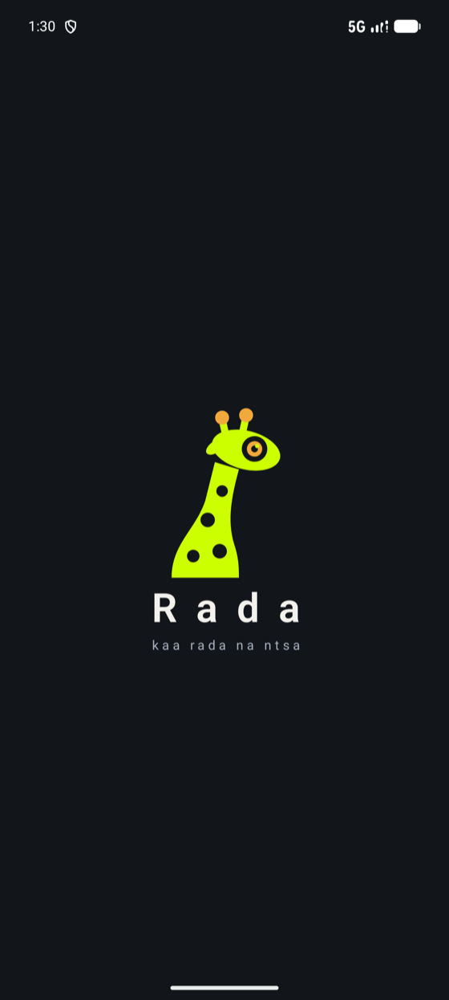
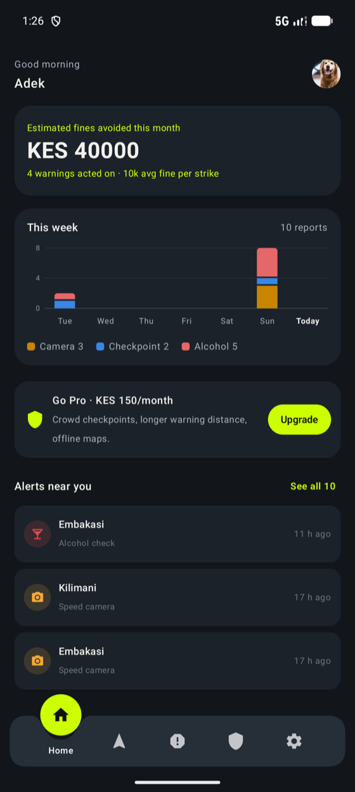
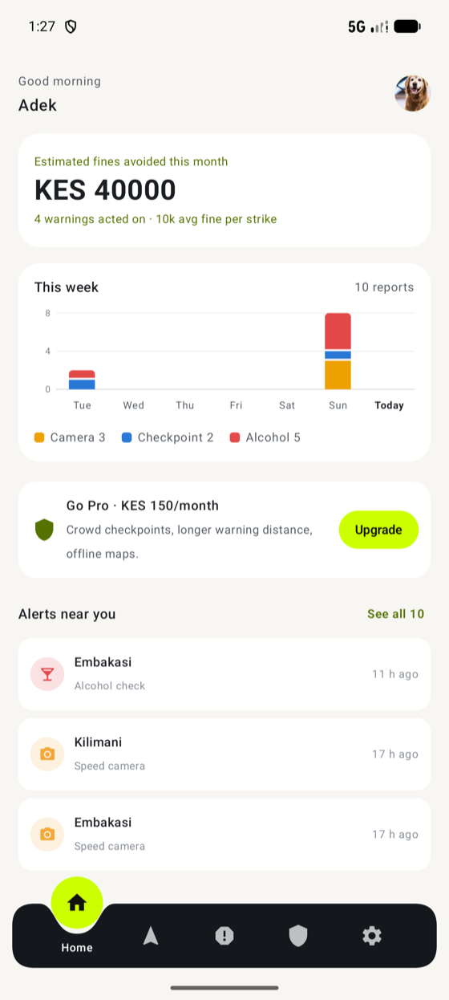
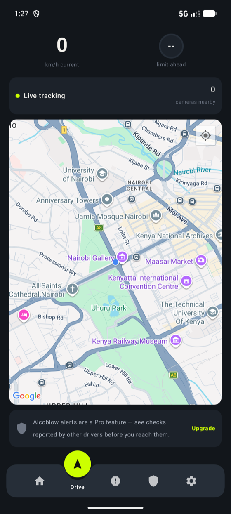
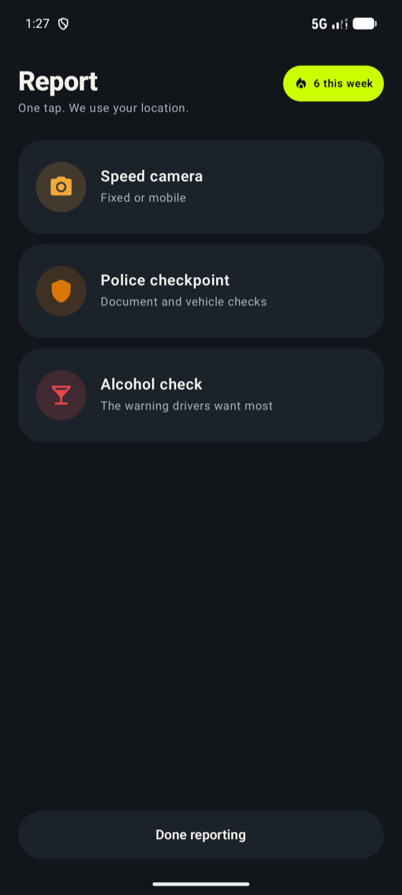
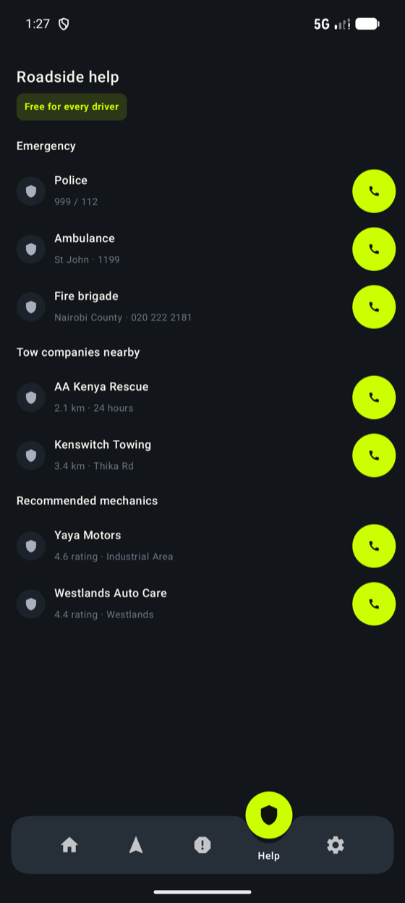

<p align="center">
  
</p>

<h1 align="center">Rada</h1>
<p align="center"><b>kaa rada na ntsa</b> · <i>stay aware on the road</i></p>

Rada is a driving-awareness app for Kenya. It warns drivers about **speed cameras, police
checkpoints and alcohol checks (“alcoblow”) before they reach them**, using a seeded set of
known camera locations plus reports from other drivers. *Rada* is Swahili for *aware*, and the
Twiga (giraffe) is the mascot: the tallest lookout on the savanna, with a camera lens for an
eye.

## Screenshots

<table align="center">
  <tr>
    <td align="center"><br><sub>Splash</sub></td>
    <td align="center"><br><sub>Home (dark)</sub></td>
    <td align="center"><br><sub>Home (light)</sub></td>
  </tr>
  <tr>
    <td align="center"><br><sub>Drive mode</sub></td>
    <td align="center"><br><sub>One-tap reporting</sub></td>
    <td align="center"><br><sub>Roadside help</sub></td>
  </tr>
</table>

<sub>Android, captured on an emulator. The alerts and chart data in these shots are test reports.</sub>

## What it does

- **Drive mode.** A live map that follows you, your current speed, and how many cameras are
  nearby. Alerts fire in time to react: the warning distance scales with your speed, and only
  cameras you are actually heading toward count.
- **One-tap reporting.** Camera, checkpoint or alcohol check, one tap each. The tile floods with
  its colour, you feel a haptic confirmation, and an **Undo** chip stays for five seconds so a
  mis-tap while driving is recoverable. A “this week” counter shows how many reports you made.
- **Home dashboard.** Estimated fines avoided, a stacked weekly chart of reports by type,
  the newest alerts near you (with “See all”), and the Pro upgrade banner.
- **Roadside help.** Emergency numbers, tow companies and mechanics, one tap to call.
- **Settings.** Profile photo, name, alert notifications and a dark-mode switch. Everything saves
  as you change it; there is no Save button.
- **Rada Pro.** A paid tier (KES 150/month or KES 1,200/year) that promises real-time crowd
  checkpoints, longer warning distance and offline maps. Only the paywall and the alcohol-check
  teaser are built so far (see Status).
- **Light and dark themes**, a lime-on-ink identity, and an adaptive launcher icon (with a
  themed variant for Android 13+).

## Tech stack, and why

| Layer | Choice | Why |
|---|---|---|
| Shared logic | **Kotlin Multiplatform** (`:shared`) | The alert engine is the part that has to be right, so it is written and tested once and reused by both apps instead of being re-implemented per platform. |
| Android UI | **Jetpack Compose** + Material 3 | Declarative UI makes the animated screens (tab bar, report tiles, charts) straightforward, and state-driven screens stay simple. |
| iOS UI | **SwiftUI** | Native feel, haptics and animation on iPhone, without forcing a shared UI toolkit on a design that leans on platform behaviour. |
| Architecture | **MVI**: one immutable state per screen, intents in, effects out | Predictable and easy to reason about. Each feature is a `Route` (owns the ViewModel) plus a `Content` screen that is a pure function of state. |
| Navigation | **Navigation Compose**, one tab bar above the `NavHost` | The active-tab circle can slide between destinations instead of being redrawn per screen. |
| Local storage | **Jetpack DataStore** (Preferences) | Small key-value data (name, theme, alert preference, report history), written as it changes. |
| Backend | **Firebase Auth + Cloud Firestore** | Crowd reports need realtime sync and an offline write queue with no server to run. Snapshot listeners feed the map and Home; distance and age filtering happens on the client, which avoids a geohash index at this report volume. |
| Location | **Play Services Fused Location** | One high-accuracy request for as long as Drive is tracking; the last known position seeds the map so it never opens on a world view. |
| Maps | **Maps Compose** (Google Maps SDK) | Fastest route to a good map. OpenStreetMap/MapLibre remains an option if map costs matter for an always-on app. |
| Async | **Kotlin Coroutines / Flow** | Location, Firestore and DataStore are all streams. |
| Build | Gradle Kotlin DSL · AGP 8.13 · Kotlin 2.3 · JDK 17 · minSdk 26 · targetSdk 36 | |

### How an alert happens

```
Fused location ─► DriverState (lat, lng, speed, bearing)
                     │
                     ▼
        SpeedAlertEngine.evaluateDriverSafety
          · alert distance scales with speed (≈7 s of reaction time, clamped 60–350 m)
          · only cameras in the direction of travel (±20°)
          · NOT_ALERTED → ALERTED → PASSED, with hysteresis so it doesn't re-fire
          · checkpoints and alcohol checks alert on presence; cameras also need overspeed
                     │
                     ▼
        AlertNotifier (notification + sound) ─► Drive screen banner
```

`CameraGridIndex` buckets cameras into ~1 km cells so each location update only checks the
cameras around you. The engine and the Drive banner work today; `AlertNotifier` (the system
notification and sound) is implemented in `:shared` but not wired into the Android app yet.

## Project layout

```
shared/          Kotlin Multiplatform: SpeedAlertEngine, CameraGridIndex, models,
                 LocationProvider / AlertNotifier (expect/actual for Android and iOS)
androidApp/      Jetpack Compose app
  └ features/    splash · onboarding · login · otp · profile · dashboard · drive ·
                 report · help · settings · paywall   (each: State + ViewModel + Route + Content)
  └ data/        Firestore repositories, DataStore preferences, auth config
  └ theme/       palette + light/dark colour schemes
iosApp/          SwiftUI app (see iosApp/SETUP.md)
docs/            screenshots and brand assets
```

## Getting started (Android)

1. Open the project in a current Android Studio (JDK 17) and let Gradle sync.
2. Add your two config files. Neither is committed:
   - `androidApp/google-services.json`, from your Firebase project (see
     `google-services.json.example` for the shape). Package name `com.rada.android`.
   - `androidApp/src/main/res/values/secrets.xml`, with your Google Maps key (copy
     `androidApp/secrets.xml.example`). The key needs **Maps SDK for Android** enabled and should
     be restricted to `com.rada.android` plus your debug SHA-1.
3. Run the `androidApp` configuration.

```
./gradlew :androidApp:assembleDebug
```

## iOS

`iosApp/` contains the SwiftUI sources and an asset catalog (app icon, launch image). There is
no `.xcodeproj` in the repo yet: create an iOS App project and add the sources, then follow
[`iosApp/SETUP.md`](iosApp/SETUP.md) for the launch screen and icon wiring (iOS 16+). The iOS
Kotlin/Native framework only builds on macOS; `:shared` builds as Android-only elsewhere.

## Status

Rada is early. What is real and what is not:

- **Real:** the alert engine and grid index, location tracking and the live map, Firestore
  crowd reports (submit, undo, live alerts and the weekly chart), local settings, theming,
  the UI on Android.
- **Stubbed:** phone sign-in (`AuthConfig.FIREBASE_ENABLED = false`, so OTP is bypassed),
  payments (Pro is an in-memory flag and only the alcohol-check teaser is gated; M-Pesa / Play
  Billing is not wired), Home's “estimated fines avoided” figure (mock), and the tow and
  mechanic phone numbers (placeholders).
- **Not built yet:** hooking `AlertNotifier` into the app (so the “Alert notifications” switch in
  Settings saves a preference that nothing reads yet), the foreground service for background
  alerts (Play Store policy for navigation apps), a bundled alert sound, and Firestore
  security rules (the `reports` collection is open while auth is off).
- **iOS is a prototype:** the screens mirror Android's design, but with mock data and local
  storage. It has no location, map or Firestore layer yet, so Drive and live reports are
  Android-only for now.

## License

Private project. No licence is granted.
